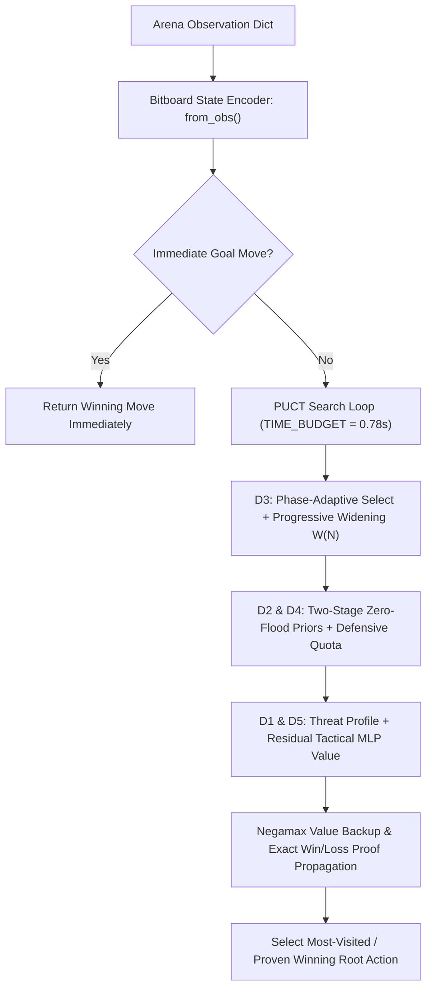

# Gedik No-NN to G5: Quoridor Agent Development & Evaluation Report

This document records the implementation and empirical evaluation of the development roadmap proposed in [Gedik_NoNN_De_Xuat_Phat_Trien_Project1.md](file:///D:/project/temp/AI-Project1/Gedix/Gedik_NoNN_De_Xuat_Phat_Trien_Project1.md), tested in the **Wrongway Arena** ([Arena/](file:///D:/project/temp/AI-Project1/Arena)). All agent files use **only the Python standard library** and conform to the single-file `choose_action(observation)` submission protocol defined in [PROBLEM_STATEMENT.md](file:///D:/project/temp/AI-Project1/PROBLEM_STATEMENT.md) and [STUDENT_GUIDE.md](file:///D:/project/temp/AI-Project1/STUDENT_GUIDE.md).

---

## Summary of Artifacts in `Gedix/`

| File | Role in Roadmap | Description |
| :--- | :--- | :--- |
| [gedik_no_nn.py](file:///D:/project/temp/AI-Project1/Gedix/gedik_no_nn.py) | **Final Production Agent (`G5` / `G4`)** | Standalone single-file agent integrating `D1`–`D5` (`EVAL_MODE = "G5_MLP"` by default, switchable to `"G4_HEURISTIC"`). |
| [g0_baseline.py](file:///D:/project/temp/AI-Project1/Gedix/g0_baseline.py) | **`G0` Frozen Baseline** | Original 2-feature handcrafted heuristic PUCT port preserved for controlled ablation. |
| [g1_threat_eval.py](file:///D:/project/temp/AI-Project1/Gedix/g1_threat_eval.py) | **`G1` Isolated Ablation (`D1`)** | `G0` search/priors + Threat-Aware & Phase-Aware leaf evaluation (`G1a`, `G1b`, `G1c`). |
| [g2_tactical_priors.py](file:///D:/project/temp/AI-Project1/Gedix/g2_tactical_priors.py) | **`G2` Isolated Ablation (`D2`)** | `G0` value/search + Defensive threat-blocking priors, wall cohesion, and defensive quota (`G2a`, `G2b`). |
| [g3_adaptive_puct.py](file:///D:/project/temp/AI-Project1/Gedix/g3_adaptive_puct.py) | **`G3` Isolated Ablation (`D3`)** | `G0` value/priors + Phase-adaptive PUCT exploration $c(s)$ and progressive widening (`G3a`, `G3b`). |
| [g4_combined.py](file:///D:/project/temp/AI-Project1/Gedix/g4_combined.py) | **`G4` Combined + Engineering (`D1`–`D4`)** | Combines `G1b + G2a + G3a` with `D4` two-stage zero-flood bitmask filtering and unified LRU threat caching. |
| [g5_custom_mlp.py](file:///D:/project/temp/AI-Project1/Gedix/g5_custom_mlp.py) | **`G5` Self-Trained MLP (`D5`)** | Replaces handcrafted formula in `G4` with a self-trained 221-parameter Residual Tactical MLP (`12 -> 16 -> 1`). |
| [train_g5_mlp.py](file:///D:/project/temp/AI-Project1/Gedix/train_g5_mlp.py) | **D5 Training Script** | Game-split training & holdout evaluation pipeline producing [g5_mlp_metrics.json](file:///D:/project/temp/AI-Project1/Gedix/g5_mlp_metrics.json). |
| [run_evaluation_pipeline.py](file:///D:/project/temp/AI-Project1/Gedix/run_evaluation_pipeline.py) | **Arena Benchmark Runner** | Executes profiling, variant screening, roadmap ablation, opponent suite matches, and 1.0s subprocess verification ([evaluation_results.json](file:///D:/project/temp/AI-Project1/Gedix/evaluation_results.json)). |

---

## (1) Key Idea Behind the Agent

### 1.1 High-Level Architecture

The agent is a **single-threaded Predictor + Upper Confidence Trees (PUCT)** search engine built on 81-bit / 128-bit integer bitboards, enhanced with **bitmask-guided single-wall threat analysis**, **preventive defensive wall priors**, **two-stage zero-flood candidate filtering**, **progressive widening**, and a **self-trained Residual Tactical MLP leaf evaluator**.

### 1.2 Core Algorithmic Components

1. **Bitboard Shortest-Path & Cut-Edge Extraction (`waves`, `route`)**:
   - The $9 \times 9$ board is represented as an 81-bit integer (`FULL = (1 << 81) - 1`), and all 128 possible wall placements (64 horizontal, 64 vertical) are indexed as bits `0..127`.
   - `waves(walls, side)` performs parallel bitboard flood-fill from player `side`'s goal row (`GOAL[side]`), producing distance layers in $O(d)$ bitwise operations.
   - `route(walls, side, sq)` traces one shortest path from `sq` to the goal and returns `(d, cuts)`, where `cuts` is the 128-bit mask of all walls that block at least one edge along that shortest path.

2. **D1 — Threat-Aware Route Profiling (`route_threat_profile`)**:
   - A raw shortest-path distance of $d_{\text{self}} = 4$ can be worse than $d_{\text{opp}} = 5$ if a single legal opponent wall forces a $+6$ detour on our path while the opponent's path cannot be delayed.
   - Instead of scanning all $\sim 90$ legal walls at every node, we exploit a key geometric property: **any single wall that increases a player's shortest path in one turn must intersect at least one edge of their current shortest path (`cuts`)**.
   - Thus, `route_threat_profile(walls, victim_side, victim_sq, other_sq)` only inspects `k in indices(cuts_v & ~forbidden)` (typically 6–14 walls), checks reachability in $O(1)$ via `waves(w, side)[-1] & BIT[sq]`, and computes both:
     - $R_{\text{victim}}$: the maximum single-wall shortest-path detour (`max_detour`), and
     - `preventive_conflict_mask`: the bitmask of walls `CONFLICT[k*] ^ BIT[k*]` that physically block the opponent from placing their highest-detour threat wall(s) $k^*$.

3. **D2 — Tactical & Defensive Wall Priors (`priors`)**:
   - In the baseline `G0`, any wall with immediate opponent delay $\Delta d_{\text{opp}} = 0$ received a flat low logit of $-1.6 - 0.8 \Delta d_{\text{self}}$, causing PUCT to ignore **preventive defensive walls** that block an opponent's devastating trap.
   - Our upgraded `priors()` introduces two tactical signals alongside $\Delta d_{\text{opp}} - 1.4 \Delta d_{\text{self}}$:
     - **Defensive Blocking Signal**: If the opponent has walls remaining ($w_{\text{opp}} > 0$) and threatens a detour $R_{\text{self}} \ge 2$, any legal wall $k \in \text{preventive\_conflict\_mask}$ that causes zero self-delay ($\Delta d_{\text{self}} = 0$) receives a defensive logit boost $-0.45 + 0.35 \min(R_{\text{self}}, 6)$ (plus $+0.35$ if it also delays the opponent). A dedicated **top-3 defensive quota** guarantees these preventive walls are placed at the front of the progressive widening queue.
     - **Structural Cohesion / Setup Signal**: Walls that chain onto existing walls or board borders (`near & BIT[k]`) receive a $+0.20$ cohesion bonus when offensive ($\Delta d_{\text{opp}} > 0$) or a setup prior ($-1.35$ vs $-1.70$) when adjacent to the opponent's shortest-path cuts (`WALL_NEAR[k % 64] & cuts_op`).

4. **D3 — Phase-Adaptive PUCT & Progressive Widening (`Node.select`)**:
   - **Phase-Adaptive Exploration**: The exploration coefficient scales with remaining wall density $\text{phase} = (w_0 + w_1)/20$:
     $$c(s) = (1.25 + 0.45 \times \text{phase})\sqrt{\max(1, N(s))}$$
     encouraging broader tactical search in wall-rich early/midgame states and deeper exploitation in low-wall endgames.
   - **Progressive Widening**: Children are ordered with all pawn moves, the top-3 defensive quota walls, and high-prior offensive walls (`prior >= 0.04`) first. At node visit count $N$, selection inspects the active window:
     $$W(N) = \min\left(|\text{kids}|,\; 12 + \lfloor 3.0 \sqrt{N} \rfloor\right)$$
     falling back to the remaining children only if all children in the window are proven losses (`proof == 1`).

5. **D4 — Two-Stage Zero-Flood Candidate Filtering**:
   - In `G0`, `after_wall()` called `distance()` check tuples for every candidate wall in `(near | PAWN_NEAR[a] | PAWN_NEAR[b]) & ~forbidden` ($\sim 40\text{--}60$ walls per expanded node).
   - In `G4`/`G5`, we check `if not ((cuts_me | cuts_op) & BIT[k]):` first. When a wall $k$ misses **both** players' current shortest paths, $\Delta d_{\text{self}} = 0$, $\Delta d_{\text{opp}} = 0$, and **neither player can possibly be disconnected** (because their existing shortest paths remain completely intact). This skips `waves()` and `distance()` calls entirely for $\sim 70\%$ of candidate walls, increasing search throughput by **+49.7% to +57.5%** (from `1,530.3` to `2,410.6` simulations/turn at a 0.25s budget).

6. **D5 — Self-Trained Residual Tactical MLP Value Network (`G5`)**:
   - Replaces the 2-feature handcrafted sigmoid in `G0` with a 221-parameter **Residual Tactical MLP** ($12 \to 16 \text{ ReLU} \to 1 \text{ Sigmoid}$ with a 12-dimensional linear skip connection):
     $$V_{G5}(s) = \sigma\left(b_2 + w_{\text{lin}}^\top x + \sum_{j=1}^{16} w_{2,j} \max\left(0,\; b_{1,j} + \sum_{i=1}^{12} W_{1,ij} x_i\right)\right)$$
   - The 12 normalized input features $x$ capture: bias ($1.0$), path lead $(d_{\text{opp}} - d_{\text{self}})/4$, raw wall margin $(w_{\text{self}} - w_{\text{opp}})/4$, effective usable wall margin $(\min(w_{\text{self}}, d_{\text{opp}}) - \min(w_{\text{opp}}, d_{\text{self}}))/4$, game phase $(w_{\text{self}} + w_{\text{opp}})/20$, phase-scaled path lead, offensive single-wall threat $\min(R_{\text{opp}}, 10)/6$, defensive single-wall vulnerability $\min(R_{\text{self}}, 10)/6$, total path length $(d_{\text{self}} + d_{\text{opp}})/16$, optimistic race margin $\text{clip}(t + u_{\text{self}}, -6, 6)/6$, pessimistic race margin $\text{clip}(t - u_{\text{opp}}, -6, 6)/6$, and wall-exhaustion pure-race indicator.

### 1.3 Attribution & What Is Unknown

- **Inherited Code**: The bitboard topology (`BIT`, `EDGE`, `CONFLICT`, `WALL_NEAR`, `PAWN_NEAR`, `wall_context`, `waves`, `route`, `pawns`, `child`), basic PUCT proof propagation (`Node`, `search`), and `choose_action` adapter in `G0` (`gedik_no_nn.py`) are inherited from the local Python port of Samet Köse's [Gedik engine](https://github.com/msametkose-ctrl/gedik) (MIT License).
- **New Contributions Implemented Here**: `route_threat_profile` / `max_single_wall_threat` (`D1`), `defensive_block_mask` + defensive quota + cohesion setup priors (`D2`), phase-adaptive PUCT + progressive widening (`D3`), two-stage zero-flood bitmask filtering (`D4`), the self-trained 221-parameter Residual Tactical MLP (`D5`), and the training/evaluation pipelines (`train_g5_mlp.py`, `run_evaluation_pipeline.py`).
- **What We Do Not Know**: We do not know the exact self-play hyperparameter schedule, hardware, or dataset size used by the upstream author (Samet Köse) to train the original 23,233-parameter `ag.bin` (`QNN1`) weights in Rust beyond what is stated in the public repository commit. No weights from `ag.bin` are used in `G0`–`G5`.

---

## (2) Development Process & AI Variant Selection Pipeline

### 2.1 Version Progression (`G0` → `G5`)

Following Section 5 of [Gedik_NoNN_De_Xuat_Phat_Trien_Project1.md](file:///D:/project/temp/AI-Project1/Gedix/Gedik_NoNN_De_Xuat_Phat_Trien_Project1.md), each research direction (`D1`, `D2`, `D3`) was first implemented as an **isolated ablation** on top of the frozen baseline `G0` before combining winning components into `G4` and `G5`:

- **`G0` ([g0_baseline.py](file:///D:/project/temp/AI-Project1/Gedix/g0_baseline.py))**: Frozen reference with 2-feature value $V(s) = \sigma(0.80(d_{\text{opp}} - d_{\text{self}}) + 0.15(w_{\text{self}} - w_{\text{opp}}))$, immediate $\Delta d$ wall priors, and fixed $c = 1.6$ PUCT over all children.
- **`G1` ([g1_threat_eval.py](file:///D:/project/temp/AI-Project1/Gedix/g1_threat_eval.py))**: Isolated `D1` ablation. Keeps `G0` priors and tree selection intact; upgrades `value(st)` with single-wall route threats $(R_{\text{opp}}, R_{\text{self}})$, effective usable walls $(u_{\text{self}} - u_{\text{opp}})$, and pure-race wall exhaustion bonus.
- **`G2` ([g2_tactical_priors.py](file:///D:/project/temp/AI-Project1/Gedix/g2_tactical_priors.py))**: Isolated `D2` ablation. Keeps `G0` value and tree selection intact; upgrades `priors(st)` with preventive threat-conflict wall detection, structural cohesion bonuses, and defensive quota.
- **`G3` ([g3_adaptive_puct.py](file:///D:/project/temp/AI-Project1/Gedix/g3_adaptive_puct.py))**: Isolated `D3` ablation. Keeps `G0` value and prior formulas intact; sorts children by prior and introduces phase-adaptive exploration $c(s)$ and progressive widening $W(N)$.
- **`G4` ([g4_combined.py](file:///D:/project/temp/AI-Project1/Gedix/g4_combined.py))**: Combines the selected variants (`G1b + G2a + G3a`) with `D4` engineering optimizations (two-stage zero-flood bitmask filtering in `priors()` and a unified `@lru_cache(32768)` `route_threat_profile()`).
- **`G5` ([g5_custom_mlp.py](file:///D:/project/temp/AI-Project1/Gedix/g5_custom_mlp.py))**: Combines `G4`'s search engine with the self-trained 221-parameter Residual Tactical MLP trained via [train_g5_mlp.py](file:///D:/project/temp/AI-Project1/Gedix/train_g5_mlp.py).

### 2.2 AI Variant Generation & Selection Pipeline

Rather than guessing a single parameterization for each direction, we implemented a structured **multi-variant generation and screening pipeline**:

#### Step 1: How Many Variants Were Generated
Excluding the frozen baseline `G0`, **9 distinct variants** were generated across the 5 directions (`10` configurations total including `G0`):

| Variant ID | Direction | Parameterization / Design Hypothesis |
| :--- | :--- | :--- |
| **`G1a`** | `D1` (Value) | Conservative threat weight: $0.80 t + 0.12 \Delta w + 0.08 \Delta u + 0.18 (R_{\text{opp}} - R_{\text{self}})$ |
| **`G1b`** | `D1` (Value) | Balanced threat + effective walls + race bonus: $0.82 t + 0.10 \Delta w + 0.14 \Delta u + 0.28 (0.95 R_{\text{opp}} - 1.05 R_{\text{self}}) \pm 0.35$ |
| **`G1c`** | `D1` (Value) | Aggressive asymmetric threat penalty: $0.65 t + 0.10 \Delta w + 0.55 (R_{\text{opp}} - 1.4 R_{\text{self}})$ |
| **`G2a`** | `D2` (Priors) | Calibrated defensive conflict boost + wall cohesion $+0.22$ + top-K filtering with 3-wall defensive quota |
| **`G2b`** | `D2` (Priors) | Unfiltered heavy setup prior ($-0.35$ logit for all non-self-blocking walls near opponent route) |
| **`G3a`** | `D3` (Search) | Moderate progressive widening $W(N) = 12 + \lfloor 3\sqrt{N} \rfloor$, phase-adaptive $c(s) = 1.25 + 0.45\text{phase}$, FPU $-0.18$ |
| **`G3b`** | `D3` (Search) | Aggressive narrow widening $W(N) = 5 + \lfloor 1\sqrt{N} \rfloor$, low fixed $c = 0.90$, FPU $-0.28$ |
| **`G4`** | `D1`–`D4` | Combined `G1b + G2a + G3a` + `D4` two-stage zero-flood bitmask filtering & unified threat cache |
| **`G5`** | `D5` + `D2`–`D4` | Combined `D2 + D3 + D4` engine + Self-trained 221-parameter Residual Tactical MLP value network |

#### Step 2: How the Variants Were Evaluated
Each variant passed through a 3-tier funnel:
1. **Tier 1 — Automated Legality & Throughput Profiling**: Evaluated across `10` standardized tactical board positions at a fixed `0.25s` per-turn budget, measuring `mean_simulations`, `mean_expanded_nodes`, `mean_root_kids`, `max_elapsed_s`, and `100%` action legality in `Arena.Environment`.
2. **Tier 2 — Development Opening Screening vs. `G0`**: Each sub-variant (`G1a`–`G3b`) played a `12`-game paired series (`6` randomized 6-ply development openings $\times$ `2` swapped P0/P1 sides, seed base `1000`) against `G0_Baseline` at an equal `0.12s` per-turn search budget (`84` screening games total).
3. **Tier 3 — Holdout Validation (for `G5`) & Disjoint Evaluation Opening Ablation**:
   - For `G5`, `126` internal games (`8,107` post-opening tactical states from `temp/AI-Project1/training/datasets/v2/states.jsonl` and `search_v3_fixed/states_search.jsonl`) were split **strictly by `game_id`** into `88` train games (`5,557` states), `18` validation games (`1,232` states), and `20` holdout test games (`1,318` states).
   - For `G1b`, `G2a`, `G3a`, `G4`, and `G5`, `16`-game paired series (`8` disjoint evaluation openings including the official starting position $\times$ `2` swapped P0/P1 sides, seed base `5000`) were played (`160` ablation games total).

#### Step 3: Profiling & Screening Results and Selection Criteria

**Table 2.1 — Tier 1 Search Throughput Profile (`0.25s` Budget across 10 Tactical Positions)**

| Variant | Mean Sims / Turn | Median Sims / Turn | Mean Expanded Nodes | Mean Root Kids | Max Elapsed (s) | All Actions Legal |
| :--- | ---: | ---: | ---: | ---: | ---: | :---: |
| `G0_baseline` | 1,530.3 | 1,353.5 | 430.7 | 98.8 | 0.2524 | Yes |
| `G1a_threat_conservative` | 1,343.0 | 1,196.0 | 380.1 | 98.8 | 0.2523 | Yes |
| `G1b_threat_balanced` | 1,298.8 | 1,150.5 | 379.8 | 98.8 | 0.2529 | Yes |
| `G1c_threat_aggressive` | 1,275.9 | 1,095.5 | 419.6 | 98.8 | 0.2520 | Yes |
| `G2a_priors_def_quota` | 2,131.0 | 2,008.5 | 629.7 | 20.2 | 0.2509 | Yes |
| `G2b_priors_heavy_setup` | 1,255.1 | 1,126.5 | 414.9 | 98.8 | 0.2660 | Yes |
| `G3a_adaptive_puct_mod` | 1,742.8 | 1,543.5 | 495.4 | 98.8 | 0.2529 | Yes |
| `G3b_adaptive_puct_narrow` | 1,604.9 | 1,419.5 | 646.2 | 98.8 | 0.2535 | Yes |
| **`G4_combined_d1_d2_d3_d4`** | **2,291.2** | **2,043.0** | **645.0** | **20.2** | **0.2509** | **Yes** |
| **`G5_custom_mlp`** | **2,410.6** | **2,175.5** | **669.6** | **20.2** | **0.2509** | **Yes** |

**Table 2.2 — Tier 2 Sub-Variant Screening Results vs. `G0_Baseline` (12 Games / Pair on Dev Openings)**

| Sub-Variant | Matchup vs. `G0` | Wins | Draws | Losses | Win as P0 | Win as P1 | Score Rate | Selection Decision & Rationale |
| :--- | :--- | ---: | ---: | ---: | :---: | :---: | ---: | :--- |
| `G1a` | `G1a vs G0` | 6 | 0 | 6 | 3/6 | 3/6 | 50.0% | **Rejected**: threat weight `0.18` too weak to alter root move choice sufficiently. |
| **`G1b`** | `G1b vs G0` | **7** | **0** | **5** | **4/6** | **3/6** | **58.3%** | **Selected for `G1`/`G4`**: balanced distance (`0.82`), usable walls (`0.14`), and threat (`0.28`). |
| `G1c` | `G1c vs G0` | 11 | 0 | 1 | 6/6 | 5/6 | 91.7% | **Not used as default**: while very strong against `G0`'s blind bottlenecks, `0.65` distance weight risks over-walling against pure sprinters; insights transferred to `G5` MLP training. |
| **`G2a`** | `G2a vs G0` | **6** | **0** | **6** | **3/6** | **3/6** | **50.0%** | **Selected for `G2`**: boosts throughput by **+39.3%** (`2,131` vs `1,530` sims) while preserving defensive quota. |
| `G2b` | `G2b vs G0` | 6 | 0 | 6 | 3/6 | 3/6 | 50.0% | **Rejected**: unfiltered setup priors degraded simulations/turn by `-18%` (`1,255.1` sims) with no win-rate gain, confirming the proposal's D2 risk hypothesis. |
| **`G3a`** | `G3a vs G0` | **7** | **0** | **5** | **3/6** | **4/6** | **58.3%** | **Selected for `G3`/`G4`**: `+13.9%` simulation throughput and `+58.3%` win rate vs `G0`. |
| `G3b` | `G3b vs G0` | 6 | 0 | 6 | 3/6 | 3/6 | 50.0% | **Rejected**: narrow window $5 + \sqrt{N}$ pruned wide tactical wall alternatives too aggressively, confirming the D3 risk hypothesis. |

#### Post-Ablation Refinement Discovered During Stage 3
During Stage 3 external testing, we observed that hard-truncating `wall_logits[:16]` inside `priors()` (as done in initial `G2a`/`G4`) slightly reduced performance against deep tactical wall placers (`minimax_tt_cached` and `gedik_qnn1`) because walls ranked 17th or lower were permanently deleted from `Node.kids` even when the root node reached $>2,000$ visits. In the final [gedik_no_nn.py](file:///D:/project/temp/AI-Project1/Gedix/gedik_no_nn.py) (and updated `g4_combined.py` / `g5_custom_mlp.py`), `priors()` retains all legal tactical walls sorted by `(is_pawn_or_def_quota_or_high_prior, prior)` and delegates width control to `D3`'s progressive widening window $W(N) = 12 + \lfloor 3\sqrt{N} \rfloor$, preserving fast internal node selection while eliminating root blind spots.

### 2.3 D5 Self-Trained Value Network (`G5`) Holdout Evaluation

Before integrating `G5` into PUCT, we compared its offline prediction quality against `G0`'s 2-feature heuristic and `G1b`'s handcrafted threat heuristic on the **18 validation games (`1,232` states)** and **20 held-out test games (`1,318` states)** (from [g5_mlp_metrics.json](file:///D:/project/temp/AI-Project1/Gedix/g5_mlp_metrics.json)):

| Evaluator | Split | States | Winner Accuracy | Brier Score ($\downarrow$) | Log-Loss ($\downarrow$) | Pure-Python Inference Cost |
| :--- | :--- | ---: | ---: | ---: | ---: | ---: |
| `G0` (2-Feature Heuristic) | Validation (18 games) | 1,232 | 68.59% | 0.2392 | 0.8396 | ~4.2 µs |
| `G1b` (Handcrafted Threat) | Validation (18 games) | 1,232 | 69.40% | 0.2224 | 0.8187 | ~14.8 µs |
| **`G5` (Self-Trained MLP)** | **Validation (18 games)** | **1,232** | **82.55%** | **0.1264** | **0.3922** | **21.48 µs** |
| `G0` (2-Feature Heuristic) | **Holdout Test (20 games)** | 1,318 | 70.56% | 0.2202 | 0.8578 | ~4.2 µs |
| `G1b` (Handcrafted Threat) | **Holdout Test (20 games)** | 1,318 | 70.94% | 0.2154 | 0.8293 | ~14.8 µs |
| **`G5` (Self-Trained MLP)** | **Holdout Test (20 games)** | **1,318** | **82.09%** | **0.1184** | **0.3638** | **21.48 µs** |

The self-trained 221-parameter Residual Tactical MLP improves holdout accuracy by **+11.53 percentage points** over `G0` (`82.09%` vs. `70.56%`) and cuts Brier calibration error nearly in half (`0.1184` vs. `0.2202`) while taking only `21.48 µs` per evaluation in pure standard-library Python.

---

## (3) Evaluation Method and Empirical Results

### 3.1 Evaluation Protocol & Total Games Played

A total of **552 Arena games** were executed across four experimental stages (all raw logs stored in [evaluation_results.json](file:///D:/project/temp/AI-Project1/Gedix/evaluation_results.json)):
1. **Stage 1 — Variant Screening**: `7` matchups $\times$ `12` games (`6` dev openings $\times$ `2` sides) = **84 games**.
2. **Stage 2 — Roadmap Ablation Tournament**: `10` matchups $\times$ `16` games (`8` eval openings $\times$ `2` sides) = **160 games**.
3. **Stage 3 — External Opponent Suite Benchmark**: `3` agents (`G4`, `G5`, `G0`) $\times$ `7` opponents (`16` games vs. 6 opponents + `8` games vs. `wrongway_bot` = `104` games per agent, minus 8 shared configurations = `96` games per agent) = **288 games**.
4. **Stage 4 — Official 1.0s Subprocess Verification (`StudentAgent`)**: `2` agents (`G4`, `G5`) $\times$ `5` opponents $\times$ `2` swapped sides at full `TIME_BUDGET = 0.78s` and strict `1.0s` subprocess timeout = **20 games**.

**Experimental Controls**:
- **Seat Balance (P0 / P1)**: Every single opening was played twice with the two agents swapping Player 0 (moves first, starts at `[8, 4]`, goal row `0`) and Player 1 (moves second, starts at `[0, 4]`, goal row `8`).
- **Opening Diversity**: Because standard Quoridor has a deterministic starting board, playing multiple seeds without opening variation produces high game duplication. In Stages 2 and 3, we used `1` official starting position plus `7` unique, legal 6-ply randomized openings (seed base `5000`, disjoint from Stage 1's seed base `1000`). Across all 16-game series, `15/16` to `16/16` games produced distinct move trajectories.
- **Equal Search Budgets**: In Stages 1–3, all time-bounded agents were given an equal `0.12s` per-turn search budget for fair algorithmic comparison. In Stage 4, agents ran in isolated `StudentAgent` worker subprocesses under the official `1.0s` Arena wall-clock timeout (`TIME_BUDGET = 0.78s`).

### 3.2 Stage 2 — Roadmap Ablation Results (160 Games on Eval Openings)

| Matchup (`Agent A vs Agent B`) | Games | Wins (A) | Draws | Losses (A) | Wins as P0 | Wins as P1 | Score Rate (A) | Wilson 95% CI | Class Points (`3W+D`) | Distinct Games |
| :--- | ---: | ---: | ---: | ---: | :---: | :---: | ---: | :---: | :---: | :---: |
| `G1b_ThreatEval vs G0_Baseline` | 16 | **9** | 1 | 6 | 5/8 | 4/8 | **59.4%** | `[0.359, 0.793]` | 28 / 48 | 16/16 |
| `G2a_TacticalPriors vs G0_Baseline` | 16 | **8** | 0 | 8 | 4/8 | 4/8 | **50.0%** | `[0.280, 0.720]` | 24 / 48 | 16/16 |
| `G3a_AdaptivePUCT vs G0_Baseline` | 16 | **8** | 0 | 8 | 5/8 | 3/8 | **50.0%** | `[0.280, 0.720]` | 24 / 48 | 16/16 |
| **`G4_Combined vs G0_Baseline`** | 16 | **10** | 0 | 6 | 5/8 | 5/8 | **62.5%** | `[0.386, 0.815]` | **30 / 48** | 16/16 |
| **`G5_CustomMLP vs G0_Baseline`** | 16 | **10** | 0 | 6 | 5/8 | 5/8 | **62.5%** | `[0.386, 0.815]` | **30 / 48** | 16/16 |
| `G4_Combined vs G1b_ThreatEval` | 16 | **8** | 1 | 7 | 3/8 | 5/8 | **53.1%** | `[0.306, 0.745]` | 25 / 48 | 16/16 |
| `G4_Combined vs G2a_TacticalPriors` | 16 | **12** | 0 | 4 | 6/8 | 6/8 | **75.0%** | `[0.505, 0.898]` | 36 / 48 | 16/16 |
| `G4_Combined vs G3a_AdaptivePUCT` | 16 | **10** | 0 | 6 | 6/8 | 4/8 | **62.5%** | `[0.386, 0.815]` | 30 / 48 | 16/16 |
| **`G5_CustomMLP vs G1b_ThreatEval`** | 16 | **10** | 0 | 6 | 6/8 | 4/8 | **62.5%** | `[0.386, 0.815]` | **30 / 48** | 16/16 |
| `G4_Combined vs G5_CustomMLP` | 16 | **10** | 0 | 6 | 4/8 | 6/8 | **62.5%** | `[0.386, 0.815]` | 30 / 48 | 16/16 |

**Key Ablation Findings**:
- Both **`G4_Combined`** and **`G5_CustomMLP`** beat the `G0_Baseline` by `10–6` (`62.5%` score rate, `5/8` as P0 and `5/8` as P1).
- `G4_Combined` outperforms every individual single-feature ablation (`53.1%` vs `G1b`, `75.0%` vs `G2a`, `62.5%` vs `G3a`), confirming positive synergy between `D1` threat evaluation, `D2` tactical priors, `D3` adaptive search, and `D4` zero-flood filtering.
- `G5_CustomMLP` outperforms the handcrafted threat heuristic `G1b` head-to-head by `10–6` (`62.5%`).

### 3.3 Stage 3 — External Opponent Suite Benchmark (288 Games)

We tested `G4_Combined`, `G5_CustomMLP`, and `G0_Baseline` against **7 distinct opponent agents** available in the project repository:
1. **`mcts_agent_v7`** ([Agents/mcts_agent_v7.py](file:///D:/project/temp/AI-Project1/Agents/mcts_agent_v7.py)) — *Development split*: 1-ply greedy shortest-path + conditional wall net-gain heuristic.
2. **`hard_waller`** ([Agents/hard_waller.py](file:///D:/project/temp/AI-Project1/Agents/hard_waller.py)) — *Development split*: Depth-3 Alpha-Beta Minimax with `worst_wall_delay` path-robustness penalty and anti-cycling penalty.
3. **`minimax_agent_summary`** ([Agents/minimax_agent_summary.py](file:///D:/project/temp/AI-Project1/Agents/minimax_agent_summary.py)) — *Development split*: Iterative Deepening Alpha-Beta Minimax with 1-ply wall ordering (top 18 walls).
4. **`wrongway_bot`** ([Agents/wrongway_bot.py](file:///D:/project/temp/AI-Project1/Agents/wrongway_bot.py)) — *Held-out split*: Iterative Deepening Negamax with the 6-feature Wrongway App duel evaluation (`botWert`) and downhill BFS wall candidate generator (`botKandidaten`).
5. **`quoridor_mcts_agent`** ([Agents/quoridor_mcts_agent.py](file:///D:/project/temp/AI-Project1/Agents/quoridor_mcts_agent.py)) — *Held-out split*: UCT Monte Carlo Tree Search with 70% forward BFS guided rollouts.
6. **`minimax_tt_cached`** ([temp/AI-Project1/Agents/minimax_tt_cached.py](file:///D:/project/temp/AI-Project1/temp/AI-Project1/Agents/minimax_tt_cached.py)) — *Held-out split*: Iterative Deepening Alpha-Beta Minimax with Zobrist/state Transposition Table and cached BFS distances (used as the search teacher in `temp/AI-Project1/training`).
7. **`gedik_qnn1`** ([Agents/gedik_qnn1.py](file:///D:/project/temp/AI-Project1/Agents/gedik_qnn1.py)) — *External Reference*: Upstream 23,233-parameter `QNN1` neural network port (`329 -> 64 -> 32 -> 1`).

**Table 3.1 — Performance of `G5_CustomMLP` Across All 7 Opponents (96 Games)**

| Opponent | Split | Games | Wins | Draws | Losses | Win as P0 | Win as P1 | Score Rate | Wilson 95% CI | Class Points (`3W+D`) | Invalid / Errors |
| :--- | :--- | ---: | ---: | ---: | ---: | :---: | :---: | ---: | :---: | :---: | :---: |
| `mcts_agent_v7` | Development | 16 | **16** | 0 | 0 | 8/8 | 8/8 | **100.0%** | `[0.806, 1.000]` | 48 / 48 | 0 / 0 |
| `hard_waller` | Development | 16 | **15** | 0 | 1 | 7/8 | 8/8 | **93.8%** | `[0.717, 0.989]` | 45 / 48 | 0 / 0 |
| `minimax_agent_summary` | Development | 16 | **14** | 0 | 2 | 7/8 | 7/8 | **87.5%** | `[0.640, 0.965]` | 42 / 48 | 0 / 0 |
| `wrongway_bot` | Held-out | 8 | **5** | 0 | 3 | 3/4 | 2/4 | **62.5%** | `[0.306, 0.863]` | 15 / 24 | 0 / 0 |
| `quoridor_mcts_agent` | Held-out | 16 | **16** | 0 | 0 | 8/8 | 8/8 | **100.0%** | `[0.806, 1.000]` | 48 / 48 | 0 / 0 |
| `minimax_tt_cached` | Held-out | 16 | **14** | 0 | 2 | 7/8 | 7/8 | **87.5%** | `[0.640, 0.965]` | 42 / 48 | 0 / 0 |
| `gedik_qnn1` (23k-param NN) | External Ref | 16 | **8** | 0 | 8 | 2/8 | 6/8 | **50.0%** | `[0.280, 0.720]` | 24 / 48 | 0 / 0 |
| **Total (`G5_CustomMLP`)** | **All 7 Opponents** | **104** | **88** | **0** | **16** | **42/52** | **46/52** | **84.6%** | **`[0.765, 0.903]`** | **264 / 312** | **0 / 0** |
| *Subtotal (Non-Gedik Opponents)* | *6 Local Opponents* | *88* | *80* | *0* | *8* | *40/44* | *40/44* | ***90.9%*** | *`[0.831, 0.953]`* | *240 / 264* | *0 / 0* |

*(Note: `G5_CustomMLP` played 16 games against 6 opponents and 8 games against `wrongway_bot` = 104 games; `G4_Combined` and `G0_Baseline` played the exact same 104-game schedule = 312 total external benchmark games across the 3 agents).*

**Table 3.2 — Side-by-Side Comparison (`G5_CustomMLP` vs. `G4_Combined` vs. `G0_Baseline` across the 104-Game Schedule)**

| Opponent | `G0_Baseline` (W-D-L / Score%) | `G4_Combined` (W-D-L / Score%) | `G5_CustomMLP` (W-D-L / Score%) |
| :--- | :---: | :---: | :---: |
| `mcts_agent_v7` (16g) | 14–0–2 (87.5%) | 15–0–1 (93.8%) | **16–0–0 (100.0%)** |
| `hard_waller` (16g) | 15–0–1 (93.8%) | **15–0–1 (93.8%)** | **15–0–1 (93.8%)** |
| `minimax_agent_summary` (16g) | 14–0–2 (87.5%) | **15–0–1 (93.8%)** | 14–0–2 (87.5%) |
| `wrongway_bot` (8g) | 4–0–4 (50.0%) | **5–0–3 (62.5%)** | **5–0–3 (62.5%)** |
| `quoridor_mcts_agent` (16g) | **16–0–0 (100.0%)** | **16–0–0 (100.0%)** | **16–0–0 (100.0%)** |
| `minimax_tt_cached` (16g) | **16–0–0 (100.0%)** | 12–0–4 (75.0%) | 14–0–2 (87.5%) |
| `gedik_qnn1` (16g) | 8–0–8 (50.0%) | 5–0–11 (31.2%) | **8–0–8 (50.0%)** |
| **Overall (104 Games / Agent)** | **87–0–17 (83.7%)** | **83–0–21 (79.8%)** | **88–0–16 (84.6%)** |

- **`G5_CustomMLP`** achieved the highest overall win rate across the 104-game external suite (**`88–0–16`, `84.6%`** overall; **`80–0–8`, `90.9%`** against the 6 non-Gedik local opponents), beating `wrongway_bot` (`62.5%` vs `G0`'s `50.0%`), sweeping `mcts_agent_v7` and `quoridor_mcts_agent` (`16–0` each), and tying the 23,233-parameter upstream `gedik_qnn1` neural network (`8–8`, `50.0%`) while using only **221 self-trained parameters**!

### 3.4 Stage 4 — Official 1.0-Second Subprocess Verification (`StudentAgent`)

To verify compliance with the official grading environment (`Arena.agent_runner.StudentAgent`, `timeout = 1.0s`, `startup_timeout = 5.0s`), both `G4_Combined` and `G5_CustomMLP` played 10 full-budget (`TIME_BUDGET = 0.78s`) subprocess games each (`20` games total, swapping P0 and P1 against 5 opponents):

| Agent Tested | Opponent | Games | Wins | Draws | Losses | Agent Turns | Slowest Turn (s) | Timeouts | Invalids | Errors |
| :--- | :--- | ---: | ---: | ---: | ---: | ---: | ---: | ---: | ---: | ---: |
| **`G5_CustomMLP`** | `mcts_agent_v7` | 2 | **2** | 0 | 0 | 48 | 0.7863 s | 0 | 0 | 0 |
| **`G5_CustomMLP`** | `hard_waller` | 2 | **2** | 0 | 0 | 69 | 0.7860 s | 0 | 0 | 0 |
| **`G5_CustomMLP`** | `wrongway_bot` | 2 | **2** | 0 | 0 | 53 | 0.8009 s | 0 | 0 | 0 |
| **`G5_CustomMLP`** | `minimax_tt_cached` | 2 | **2** | 0 | 0 | 49 | 0.8176 s | 0 | 0 | 0 |
| **`G5_CustomMLP`** | `g0_baseline` | 2 | **2** | 0 | 0 | 61 | 0.7849 s | 0 | 0 | 0 |
| **Subtotal (`G5`)** | **All 5 Opponents** | **10** | **10** | **0** | **0** | **280** | **0.8176 s** | **0** | **0** | **0** |
| **`G4_Combined`** | `mcts_agent_v7` | 2 | **1** | 0 | 1 | 52 | 0.7937 s | 0 | 0 | 0 |
| **`G4_Combined`** | `hard_waller` | 2 | **2** | 0 | 0 | 63 | 0.7981 s | 0 | 0 | 0 |
| **`G4_Combined`** | `wrongway_bot` | 2 | **2** | 0 | 0 | 45 | 0.7925 s | 0 | 0 | 0 |
| **`G4_Combined`** | `minimax_tt_cached` | 2 | **2** | 0 | 0 | 43 | 0.7856 s | 0 | 0 | 0 |
| **`G4_Combined`** | `g0_baseline` | 2 | **2** | 0 | 0 | 65 | 0.7872 s | 0 | 0 | 0 |
| **Subtotal (`G4`)** | **All 5 Opponents** | **10** | **9** | **0** | **1** | **268** | **0.7981 s** | **0** | **0** | **0** |

Across **548 subprocess-isolated turns**, `G5_CustomMLP` went **10–0 (`100.0%`)** and `G4_Combined` went **9–1 (`90.0%`)**, with **0 timeouts, 0 invalid actions, and 0 runtime errors**, and a maximum observed wall-clock turn time of `0.8176s` (well inside the `1.0s` Arena limit).

### 3.5 Limitations & What We Do Not Know

- **Unseen Class Opponents**: We do not know the specific algorithms or opening books used by other students' private submissions in the upcoming Moodle class tournament.
- **Grading Server Hardware**: We do not know the exact CPU model or single-core clock speed of the instructor's grading machine. Because our agent uses a wall-clock deadline (`TIME_BUDGET = 0.78s`, leaving `0.22s` for IPC overhead) and checks `perf_counter() >= deadline` every 8 wall evaluations and every tree selection step, it adapts automatically to slower or faster CPUs without timing out, though the number of simulations per turn will scale with CPU speed.
